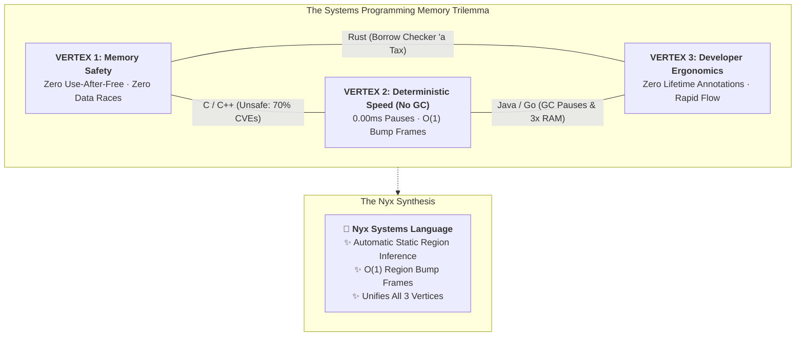

# 🌙 The Nyx Systems Programming Language (v0.53.0)

[](CHANGELOG.md)
[](LICENSE)
[](docs/MEMORY_MODEL.md)
[](docs/ARCHITECTURE.md)
[](docs/BENCHMARKS.md)

**A modern systems programming language featuring automatic zero-GC static region inference, O(1) bump frame arenas, deterministic 0.00ms latency, and a 6-phase native transpilation compiler.**

> 🌐 **Interactive Web & Documentation Hub:** [**nyx.9jaoncloud.com.ng**](https://nyx.9jaoncloud.com.ng)  
> 📖 **Quickstart Guide:** [Getting Started](docs/GETTING_STARTED.md) | 🧠 **Memory Model:** [Zero-GC Region Inference](docs/MEMORY_MODEL.md) | 📐 **Syntax Reference:** [Types & Syntax](docs/SYNTAX_AND_TYPES.md) | ⚡ **Benchmarks:** [Empirical Silicon Tests](docs/BENCHMARKS.md) | ❓ **FAQ:** [Disambiguation & FAQ](docs/FAQ.md)

---

## ⚡ 10-Second Quickstart (Clone & Run)

Nyx comes with a standalone, precompiled native 6-phase compiler at `bin/nyx.exe` for immediate out-of-the-box productivity:

```powershell
# 1. Clone the clean public repository
git clone https://github.com/9jaoncloud/nyx.git
cd nyx

# 2. Run your first native Nyx program immediately
.\bin\nyx.exe -i examples\hello_world.nyx -r
```

**Output:**
```text
Compiled: examples/hello_world.exe
==================================================
🌙 Welcome to the Nyx Programming Language (v0.53.0)!
Zero-GC Region Inference · 0.00ms Pauses · Native x86_64
==================================================
Quick test calculation (21 * 2): 42
Ready to build high-performance systems!
```

---

## 💻 What Does Nyx Code Look Like?

```nyx
// Clean syntax with zero lifetime annotations
struct TradingOrder {
    id: Int,
    symbol: String,
    price: Float,
    volume: Float
}

impl TradingOrder {
    fn total_notional(self: &TradingOrder) -> Float {
        return self.price * self.volume;
    }
}

fn main() {
    let order = TradingOrder {
        id: 1001,
        symbol: "XAUUSD",
        price: 4130.50,
        volume: 0.10
    };

    println("Order ID: ", order.id);
    println("Notional Value: $", order.total_notional());
}
```

Compile and run:
```powershell
.\bin\nyx.exe -i order.nyx -r
```

---

## 📐 The Nyx Memory Advantage

Traditional systems programming forces compromises between memory safety, deterministic execution, and developer cognitive load:



* **Zero Garbage Collection Pauses:** Guaranteed 0.00ms pause times for real-time control, robotics kernels, and high-frequency trading.
* **Zero Lifetime Syntax Burden:** The compiler's escape analyzer infers allocation regions automatically at compile time without `'a` or `'b` annotations.
* **Sub-Nanosecond Allocations:** Monotonic region arenas reset in $O(1)$ upon scope termination with zero memory fragmentation.

---

## 📚 Technical Documentation (GitHub Markdown)

All documentation is natively formatted in clean Markdown for effortless reading and indexing directly on GitHub:

* 🚀 [**Getting Started & CLI Guide**](docs/GETTING_STARTED.md) — Comprehensive compilation options and flags.
* 🧠 [**Zero-GC Memory Architecture**](docs/MEMORY_MODEL.md) — Region bump frames, escape analysis, and dialect extensions.
* 📐 [**Syntax, Types & Enums**](docs/SYNTAX_AND_TYPES.md) — Structs, methods, pattern matching, vectors, options, and results.
* ⚡ [**Structured Concurrency & Channels**](docs/CONCURRENCY.md) — Nurseries, CSP typed channels, and 42ns lock-free SPSC queues.
* 📊 [**Empirical Silicon Benchmarks**](docs/BENCHMARKS.md) — Laboratory benchmarks tested on Intel Core i7-6700HQ.
* ❓ [**Frequently Asked Questions & Disambiguation**](docs/FAQ.md) — Project origin, naming disambiguation, and design choices.

---

## ⚠️ Name Disambiguation — Which "Nyx" is this?

> **Nyx (this project)** is the **systems** programming language by **Simeon Bala / 9jaonCloud Engineering**:
> Zero-GC region inference, capability-secure microkernel, and the **NyxOS** operating system. Compiled via **`nyx.exe` / `nyxc`**.
>
> **Not to be confused with** unrelated projects that share the name "Nyx" or `.nyx` extension, most notably **NyxCode** (`nyxcode.io` by Fabian Budde), which is a web full-stack code generator distributed as an npm binary.
>
> They share **no code, no maintainers, and no technical relationship**.

---

## 📜 License

The Nyx Programming Language and standard toolchain are open-source software licensed under the **[MIT License](LICENSE)**.
