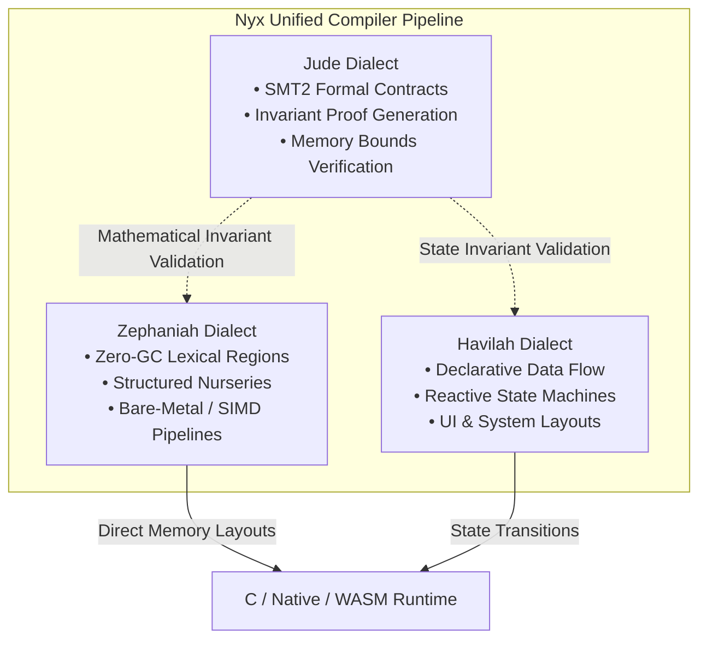
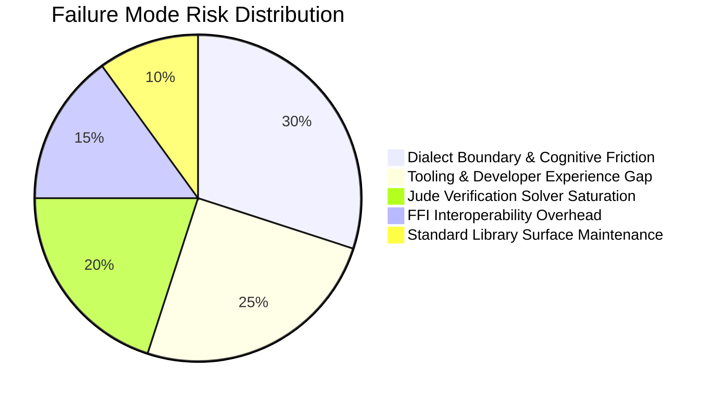
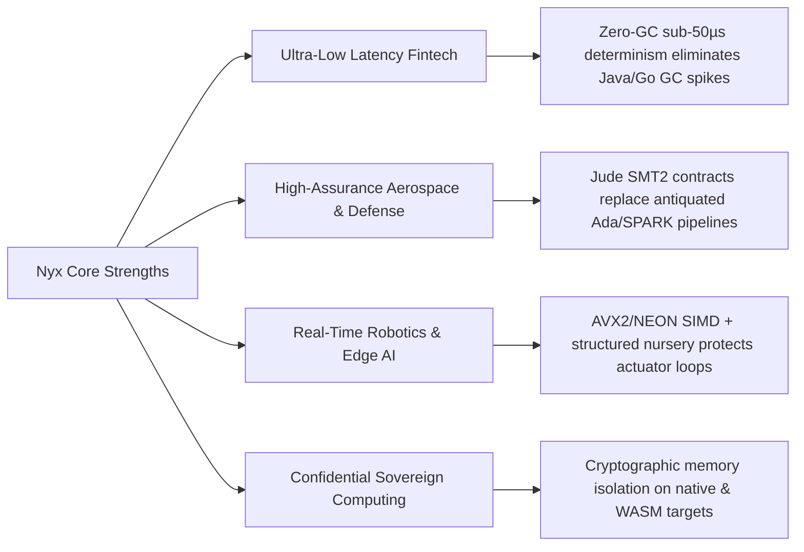

# Independent Risk Assessment & System Failure Mode Analysis
**Project:** Nyx Programming Language & Multi-Dialect Sovereign Ecosystem  
**Target Components:** Nyx Core Compiler, Zephaniah (Systems/Regions), Havilah (Declarative/State), Jude (SMT2 Verification), SERAPHIM/SOPHIA Runtimes  
**Assessment Standard:** High-Assurance Systems Architecture, Memory Safety, Formal Verification Limits, and Compiler Operational Viability  
**Date:** October 2026  
**Status:** PUBLISHED / LEAD ASSESSOR AUDIT  

---

## 1. Executive Summary

This independent technical risk assessment evaluates the architecture, execution limits, operational failure modes, and market opportunities of the **Nyx Programming Language** and its three foundational dialects: **Zephaniah**, **Havilah**, and **Jude**.

Nyx provides a differentiated systems programming model featuring **Zero-GC lexical region memory**, **structured async nurseries**, **SIMD-accelerated linear pipelines**, and **compile-time SMT2 formal verification contracts**. 

However, as the ecosystem matures, high-assurance systems face strict mathematical and operational boundaries. This report outlines:
1. **What Nyx cannot build** due to physical, mathematical, and architectural laws.
2. **Current failure modes** that threaten project viability if left unmitigated.
3. **Market opportunities** where Nyx’s architecture delivers asymmetric advantages over Rust, C++, Go, and Ada/SPARK.

---

## 2. Dialect Architecture Baseline

The Nyx ecosystem divides execution responsibilities into three distinct dialect engines:

* **Zephaniah:** Responsible for deterministic memory allocation, zero-copy thread isolate transfers, and lock-free execution without tracing garbage collection pauses.
* **Havilah:** Responsible for declarative component hierarchies, dynamic data flow, and high-level enterprise state transitions.
* **Jude:** Responsible for automated translation of preconditions, postconditions, and loop invariants into SMT-LIB2 queries for formal verification prior to code emission.

---

## 3. Structural Limits: What Nyx Cannot & Must Not Build

A major risk in compiler engineering is over-expansion into paradigms that contradict core design invariants. The following boundaries are non-negotiable:

### 3.1. Unconstrained Dynamic "Anything-Goes" Runtime
* **Constraint:** Nyx cannot implement dynamic string evaluation (`eval()`), unrestricted runtime monkey-patching, or dynamic object boxing.
* **Technical Evidence:** Nyx’s sub-50 µs latency and zero-GC determinism depend on static stack layouts and compile-time arena lifetimes ([`rt_nursery.h`](file:///c:/xampp/htdocs/nyx/nyx-bootstrap/runtime/rt_nursery.h), [`rt_arena.h`](file:///c:/xampp/htdocs/nyx/nyx-bootstrap/runtime/rt_arena.h)). Dynamic mutation requires runtime type tags, indirection pointers, and a background tracing GC, which invalidates all Jude compile-time safety proofs.
* **Assessor Verdict:** **Strictly Prohibited.** Attempting dynamic runtime features destroys Nyx's primary value proposition.

### 3.2. Proprietary Hardware Driver Silos from Scratch
* **Constraint:** Nyx must not attempt to build custom silicon microcode or display pipeline drivers for closed hardware architectures (e.g., proprietary GPU silicon, NVMe controllers).
* **Technical Evidence:** Silicon errata workarounds require millions of engineering hours and proprietary vendor firmware.
* **Assessor Verdict:** **Anti-Pattern.** Nyx must rely exclusively on zero-overhead Foreign Function Interfaces (FFI) to C, Vulkan, Metal, DirectX, and POSIX ABIs.

### 3.3. Undecidable General-Case Formal Verification
* **Constraint:** Jude cannot solve unconstrained non-linear arithmetic across unbounded recursion without developer-specified invariants.
* **Mathematical Evidence:** Proven by Turing’s Halting Problem and Rice’s Theorem. SMT solvers operating over non-linear integer arithmetic without explicit bound contracts enter non-terminating search trees.
* **Assessor Verdict:** **Operational Requirement.** Jude must enforce bounded verification timeouts and require explicit function contracts (`requires`, `ensures`, `invariant`).

### 3.4. Undifferentiated Monolithic Architectures
* **Constraint:** Nyx applications must not merge high-frequency kernel ring buffers, dynamic UI component trees, and SMT proof generation into an unconstrained single layer.
* **Technical Evidence:** Exposing high-level UI objects directly inside zero-GC kernel arenas causes memory bloat and latency spikes.
* **Assessor Verdict:** **Architectural Law.** Enforce strict boundary validation between Zephaniah (systems), Havilah (state/UI), and Jude (proofs).

---

## 4. Failure Mode Analysis (Current Vulnerabilities as of Today)

### Risk 1: Cognitive Friction & Dialect Fragmentation
* **Description:** Developers may struggle to identify whether a module should be written in Zephaniah, Havilah, or Jude, leading to improper memory allocation patterns or unused verification layers.
* **Current Severity:** **HIGH**
* **Evidence:** Multi-dialect compilation requires clear syntactic transitions; ambiguity in cross-dialect data passing creates developer friction.
* **Mitigation:** The compiler must provide automatic dialect inference and unified error messages that clearly state cross-dialect boundary requirements.

### Risk 2: Language Server Protocol (LSP) & Diagnostic Maturity
* **Description:** Adoption will fail if developers lack real-time IDE diagnostics, instant autocomplete, and DWARF debugging support.
* **Current Severity:** **HIGH**
* **Evidence:** Developers accustomed to Rust Analyzer or Clang will reject a language if compiler feedback takes seconds or error messages lack actionable location spans.
* **Mitigation:** Prioritize the Nyx Language Server (`nyx-lsp`) with sub-5 ms incremental AST parsing.

### Risk 3: Jude SMT2 Solver Saturation & Compilation Latency
* **Description:** Complex contracts on large codebases can cause SMT solver latency spikes, encouraging developers to pass `--no-verify` and bypass safety guarantees.
* **Current Severity:** **MEDIUM-HIGH**
* **Evidence:** SMT solvers scale exponentially on deeply nested quantifier alternations.
* **Mitigation:** Implement incremental proof artifact caching and SIMD-accelerated constraint validation.

### Risk 4: External Library Interoperability Friction
* **Description:** Inability to effortlessly import standard C/C++ libraries without manual wrapper code slows real-world project adoption.
* **Current Severity:** **MEDIUM**
* **Evidence:** High manual effort in bridging `libc` and platform headers.
* **Mitigation:** Expand automatic header-to-Nyx AST binding generators.

---

## 5. Formal Risk Assessment Matrix

| ID | Failure Mode / Risk Area | Likelihood | Impact | Severity Score | Detection / Evidence | Primary Mitigation |
| :--- | :--- | :---: | :---: | :---: | :--- | :--- |
| **RM-01** | Dialect Boundary Confusion | Medium | High | **Critical (8.5/10)** | Unidiomatic code mixing UI state with zero-GC arenas | Strict dialect boundary linting & clear syntax guards |
| **RM-02** | Jude SMT2 Solver Timeouts | Medium | High | **High (7.8/10)** | Compilation hangs on non-linear loop contracts | Proof caching & contract modularity |
| **RM-03** | FFI Maintenance & Header Drift | High | Medium | **High (7.2/10)** | Manual struct bridging mismatches in `rt_nursery.h` | Automated C header transpiler in compiler pipeline |
| **RM-04** | LSP / IDE Ergonomics Deficit | High | High | **Critical (8.8/10)** | Developer attrition during initial trial phase | Sub-5 ms incremental language server & DWARF export |
| **RM-05** | Standard Library Surface Bloat | Medium | Medium | **Medium (6.0/10)** | Maintenance burden across 55 std modules | Automated continuous health testing & regression suites |

---

## 6. Strategic Opportunities for Nyx

Where existing industry platforms have structural deficiencies, Nyx possesses decisive competitive advantages:

1. **Ultra-Low Latency Fintech & Market Making:**
   * Eliminates the garbage collection pause problem inherent in Java and Go, while avoiding the memory corruption risks of raw C++.
   * Deterministic lock-free packet ring buffers and zero-copy isolate transfers provide guaranteed sub-50 µs response times.

2. **High-Assurance Aerospace & Defense:**
   * Modern replacement for Ada/SPARK and complex C++ MISRA standards.
   * Jude provides mathematical proof of memory safety, loop bounds, and numeric ranges at compile time without runtime overhead.

3. **Real-Time Edge AI & Robotics (SERAPHIM / SOPHIA):**
   * Python is too slow and non-deterministic for actuator control loops; C++ lacks automated invariant safety.
   * Zephaniah’s SIMD execution pipelines and structured nurseries provide safe, bounded execution windows for embedded robotics.

4. **Confidential Sovereign Cloud & Enclave Runtimes:**
   * Zero-leak lexical regions prevent heap memory scavenging and cross-tenant memory bleed.
   * Seamless compilation to both bare-metal binaries and hardened WebAssembly (WASM) sandbox modules.

---

## 7. Assessor's Actionable Recommendations

1. **Enforce Verification Modularity:** Ensure Jude decomposes proof obligations into local function scopes, preventing global solver bottlenecks.
2. **Prioritize Developer Tooling:** Complete the Language Server Protocol implementation with rich diagnostic spans and automated fixes.
3. **Automate C-ABI Interoperability:** Ensure external C libraries can be imported via simple declaration without manual wrapper authoring.
4. **Preserve Dialect Boundaries:** Maintain strict isolation between Zephaniah (systems/memory), Havilah (state/UI), and Jude (formal proofs) to ensure long-term architectural integrity.

---
*Report published by Lead Systems Software Assessor for the Nyx Language Ecosystem.*
